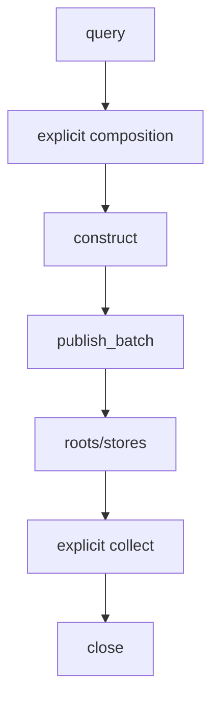
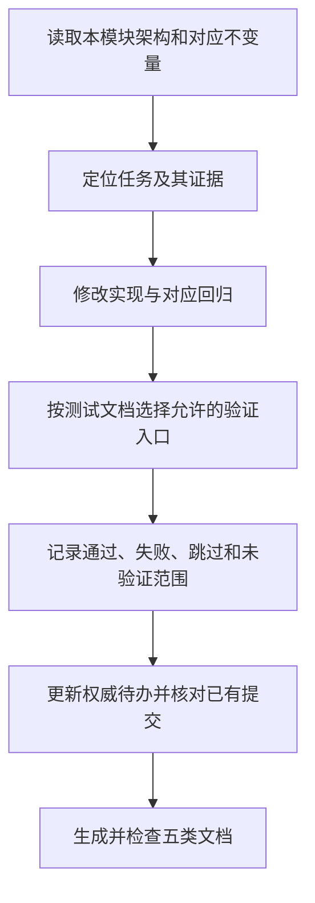

<!-- Generated by tools/knowledge_base.py; edit the generator, then regenerate. -->

# opengc/include / 处理流程与维护流程

## 读取契约

- 仅处理本目录直接文件；子目录有自己的同名文档。按下面的 file 路径检索文件条目。
- 当前实现以源码为准；任务状态以 docs/todo.md 为准；未执行不等于通过。
- 词法符号不是完整 AST；直接 include 不是运行时调用，也不是行为覆盖证明。

同目录文档：[ARCHITECTURE.md](ARCHITECTURE.md) · [BACKLOG.md](BACKLOG.md) · [TEST_CASES.md](TEST_CASES.md) · [WORKFLOW.md](WORKFLOW.md)。

上级同类文档：[opengc/WORKFLOW.md](../WORKFLOW.md)。

## 子模块入口

- [opengc/include/opengc](opengc/WORKFLOW.md)

## 模块处理流程

流程来自模块职责及实现阅读路线；图中顺序是处理阶段，不穷举所有分支。

## 阶段数据

| stage_id | operation |
|---|---|
| stage0 | query |
| stage1 | explicit composition |
| stage2 | construct |
| stage3 | publish_batch |
| stage4 | roots/stores |
| stage5 | explicit collect |
| stage6 | close |

## 实现定位

- [opengc/README.md](../README.md)
- [opengc/PROTOCOL.md](../PROTOCOL.md)
- [opengc/include/opengc/protocol.h](opengc/protocol.h)
- [opengc/include/opengc/opengc.h](opengc/opengc.h)
- [opengc/src/domain.cpp](../src/domain.cpp)
- [opengc/src/full.cpp](../src/full.cpp)

## 修改与验收流程

文档命令：`python3 tools/knowledge_base.py`；只读检查：`python3 tools/knowledge_base.py --check`。

本目录仅承担层级导航；细节见子模块同类文档。
